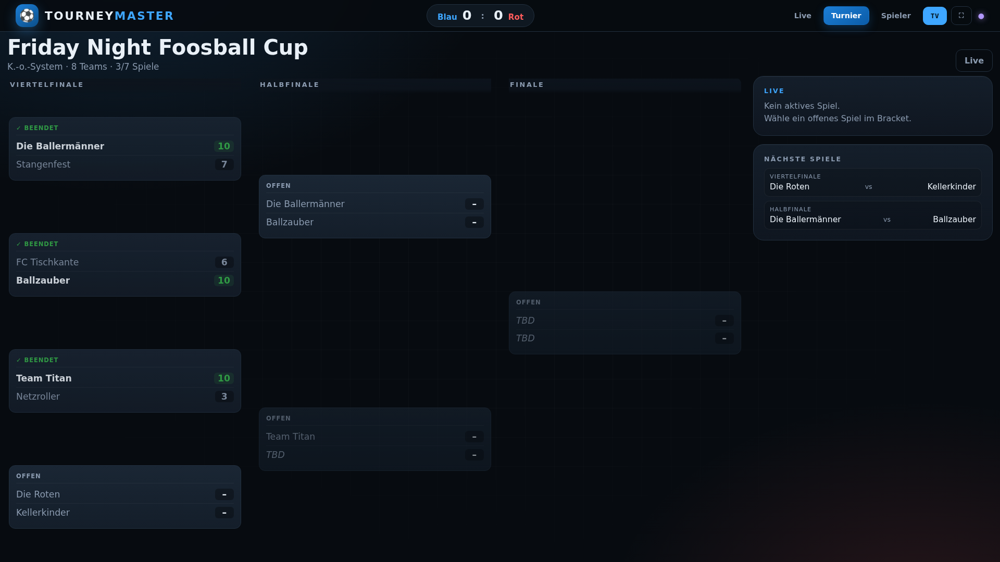
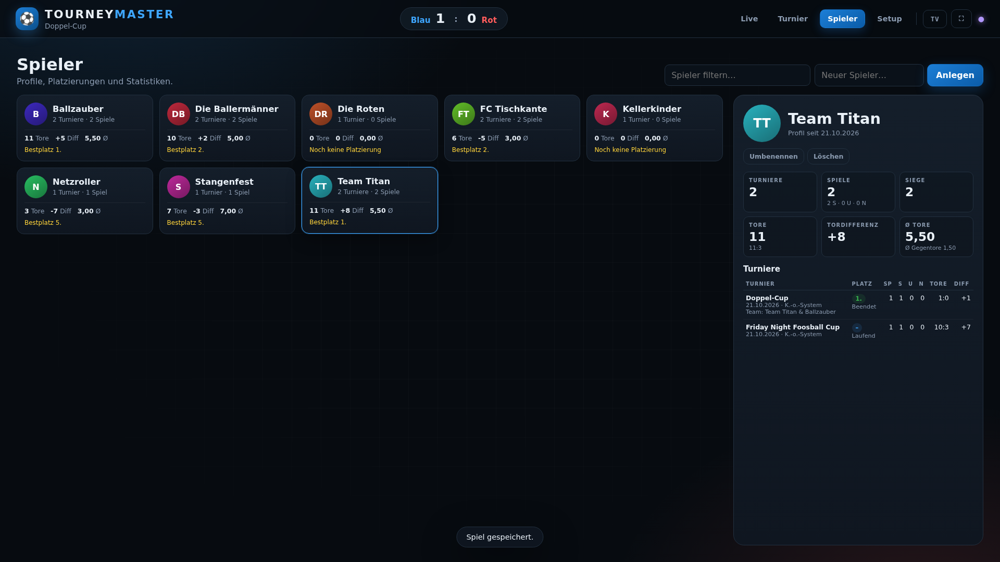

# Drehfussball — automatischer Tischkicker

ESP32-gesteuerter Drehfußball-Tisch mit automatischer Torerkennung, LED-Anzeige
und Web-Turnierdashboard.

## Schnellstart

### Dashboard lokal / TV

```bash
cd dashboard
python3 -m pip install -r requirements.txt
python3 server.py
```

- **Live / Operator:** <http://localhost:8000/>
- **TV-/Turnieransicht:** <http://localhost:8000/tv> (oder `?tv=1`)
- **Demo-Turnier:** <http://localhost:8000/?demo=1&tv=1>
- **Gruppenphase:** zufälliger, ausbalancierter Spielplan mit Spieltagen und
  rotierenden Freilosen („Spielplan mischen“ vor dem ersten Spiel).
- **Spielerprofile:** jeder Spieler bekommt ein Profil im Browser-Speicher;
  Übersicht mit Platzierungen, Toren, Tordifferenz, Ø Toren und Turnierhistorie.
- **Teams für 2 gegen 2:** beim Anlegen 1–2 Spieler zu einem Turnier-Team
  gruppieren. Teams brauchen keinen Namen und werden automatisch als
  „Alice & Bob“ angezeigt.
- **Spielerauswahl:** beim Tippen erscheinen Vorschläge, ein Klick legt den
  Spieler in den Team-Slot; neue Namen werden direkt als Profil angelegt.
- **Teams übernehmen:** aus einem bestehenden Turnier alle oder die Top N Teams
  inklusive Gruppierung ins neue Turnier übernehmen.





Details: [dashboard/README.md](dashboard/README.md)

### Firmware

```bash
pio run -t upload
```

- Firmware: `src/main.cpp`
- Nach Dashboard-Änderungen: `python3 dashboard/build_site.py` (schreibt
  `src/site.cpp`), dann flashen.
- Partition: `huge_app.csv` (3 MB App, 1 MB SPIFFS), weil die Firmware inkl.
  Dashboard ca. 1,46 MB groß ist.
- Tor 1: J6 / S1 → GPIO27, Tor 2: J8 / S3 → GPIO32. Die 74HC14 invertieren:
  Strahl blockiert = GPIO HIGH. J7/J9 sind Reserve.

### Platine

- Fertigungspaket: `hardware/Drehfussball_Controller_Gerber.zip`
- Pinbelegung, BOM, Bestückung: [hardware/README.md](hardware/README.md)
- KiCad: `hardware/Drehfussball_Controller.kicad_pcb`
- DRC: 0 Verstöße, 0 unverbundene Pads.

## Struktur

| Pfad | Inhalt |
|---|---|
| `src/main.cpp` | ESP32-Firmware (IR-Tore, LEDs, Stepper, WebSocket) |
| `src/site.cpp` | Generiertes Dashboard-HTML für den ESP32 |
| `dashboard/` | Dashboard-Quelle, lokaler Server, Screenshots |
| `hardware/` | KiCad-PCB, Gerber, BOM, Hardware-Doku |

## Hinweis

Der lokale `dashboard/server.py` simuliert den ESP32-WebSocket nur. Auf dem
ESP32 selbst läuft dieselbe Oberfläche unter `http://192.168.4.1/` (AP-Modus)
bzw. `http://192.168.4.1/?tv=1` für die TV-Ansicht.
