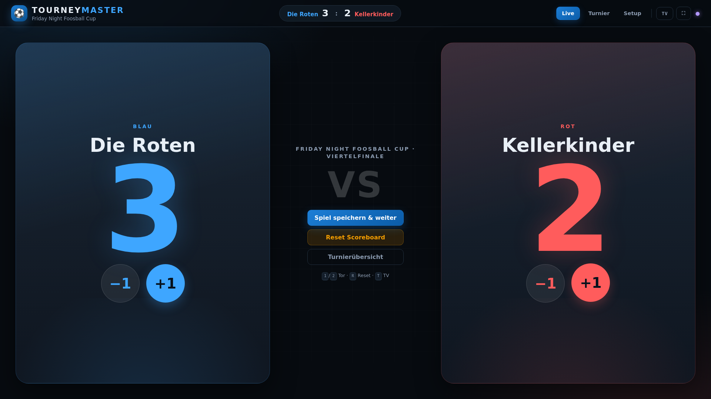
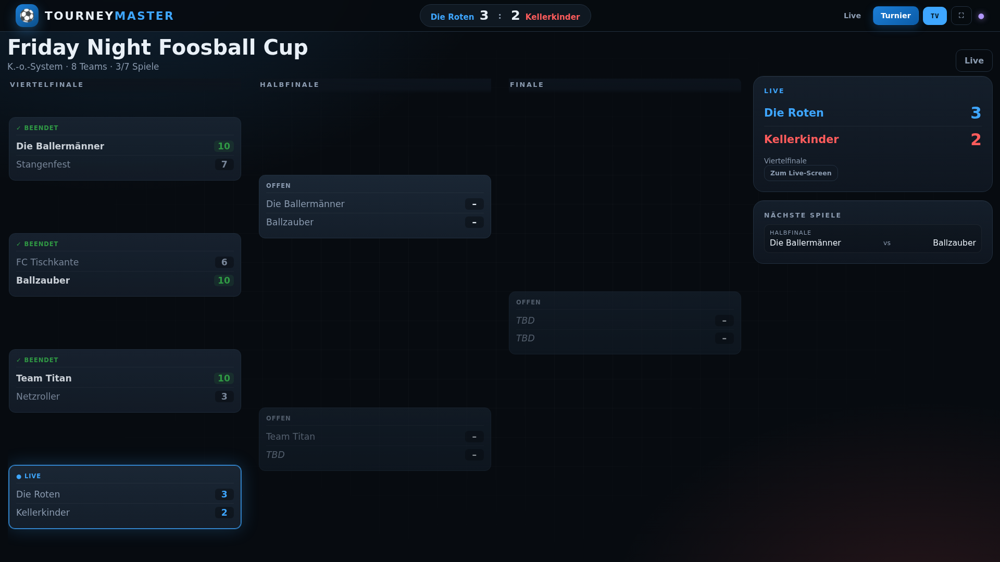
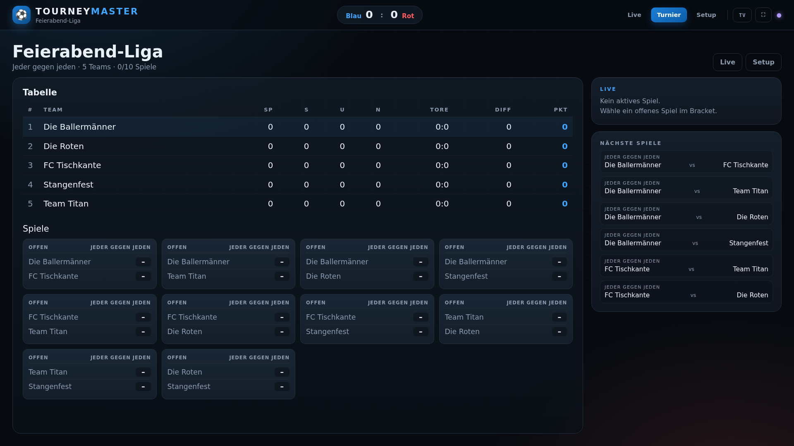
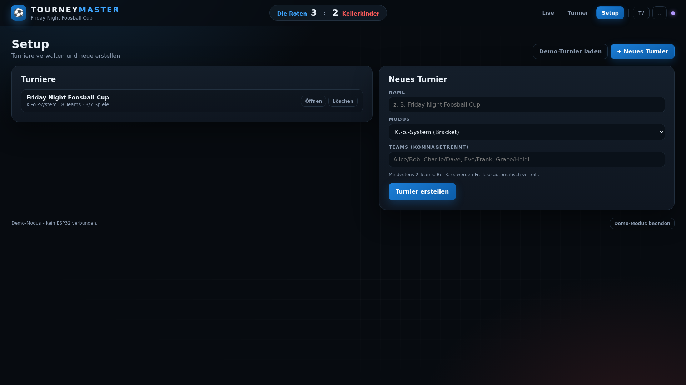

# Tourney Master — Dashboard

Das Dashboard, das der ESP32 ausliefert, liegt hier als editierbare Quelle:

| Datei | Zweck |
|---|---|
| `index.html` | Struktur |
| `styles.css` | Layout / Large-Screen-Design |
| `app.js` | Turnierlogik, Bracket, WebSocket, IndexedDB |
| `build_site.py` | Inlined alles nach `dist/index.html` und `src/site.cpp` |
| `server.py` | Lokaler HTTP- + WebSocket-Mock-Server |
| `dist/index.html` | Generierte, eigenständige Version (nicht direkt editieren) |

## Vorschau

Alle Screenshots sind 1920 × 1080.










## Lokal starten

```bash
cd dashboard
python3 -m pip install -r requirements.txt
python3 server.py
```

Dann öffnen:

- **Live / Operator:** `http://localhost:8000/`
- **TV-/Turnieransicht:** `http://localhost:8000/tv`
- **Demo-Turnier:** `http://localhost:8000/?demo=1&tv=1`

Der Server liefert dasselbe HTML wie der ESP32 und simuliert unter `/ws` den
ESP32-WebSocket (`t1_add`, `t1_sub`, `t2_add`, `t2_sub`, `reset`). Mehrere
Browser/TVs können gleichzeitig zuschauen; alle bekommen denselben Spielstand.

### Auf einem großen Bildschirm / TV

```bash
python3 server.py --host 0.0.0.0
```

Dann auf dem TV im Browser öffnen:

```
http://<IP-des-Rechners>:8000/tv
```

Mit `?tv=1` oder `/tv` werden Bedienelemente ausgeblendet und das Bracket
füllt den Bildschirm. `F` = Vollbild, `T` = TV-Modus.

## Demo-Modus ohne Server

`http://localhost:8000/?mock=1` (oder die generierte `dist/index.html` direkt
öffnen) nutzt einen eingebauten WebSocket-Mock. Damit lässt sich die Oberfläche
ohne ESP32 und ohne laufenden Server testen. Für dauerhafte Turnierdaten
(IndexedDB) ist `http://localhost` besser als `file://`.

## Nach Änderungen

```bash
cd dashboard
python3 build_site.py      # schreibt dist/index.html und ../src/site.cpp
cd ..
pio run -t upload          # Firmware mit neuem Dashboard flashen
```

`server.py` ruft `build_site.py` beim Start automatisch auf. Nach einer
Änderung also den Server neu starten (oder `build_site.py` manuell ausführen).

## Aufbau

- **Live:** riesige Anzeige für Blau/Rot, +/−-Buttons, Reset, Save Match.
- **Turnier:** Bracket (K.-o.) bzw. Tabelle + Spiele (jeder gegen jeden),
  Live-Karte und „Nächste Spiele“ in der Sidebar.
- **Setup:** Turniere anlegen/löschen, Demo-Turnier laden.
- **TV-Modus:** keine Bedienelemente, Bracket/Tabelle im Vollbild.
- **Tastatur:** `1`/`2` Tor, `R` Reset, `T` TV, `F` Vollbild.
- **Offline:** keine externen Fonts, Icons oder CDNs — läuft im ESP32-AP.

## Verbindung zum ESP32

Das Dashboard verbindet sich mit `ws://<host>/ws`. Auf dem ESP32 ist das
`ws://192.168.4.1/ws`; lokal ist es der Mock-Server. Die Nachrichten und das
JSON-Format sind identisch.

Auf dem ESP32:

- Live: `http://192.168.4.1/`
- TV: `http://192.168.4.1/?tv=1` oder `http://192.168.4.1/tv`

Der ESP32 liefert die in `src/site.cpp` eingebettete Version aus; die lokale
`dist/index.html` ist identisch. Nach Dashboard-Änderungen daher
`build_site.py` ausführen und die Firmware neu flashen.
