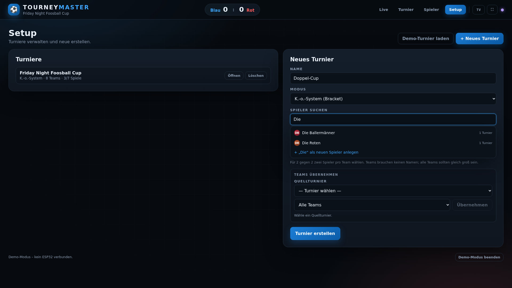

# Tourney Master — Dashboard

Das Dashboard, das der ESP32 ausliefert, liegt hier als editierbare Quelle:

| Datei | Zweck |
|---|---|
| `index.html` | Struktur |
| `styles.css` | Layout / Large-Screen-Design |
| `app.js` | Turnierlogik, Bracket, Teams, Spielerprofile, Autocomplete, WebSocket, IndexedDB |
| `build_site.py` | Inlined alles nach `dist/index.html` und `src/site.cpp` |
| `server.py` | Lokaler HTTP- + WebSocket-Mock-Server |
| `dist/index.html` | Generierte, eigenständige Version (nicht direkt editieren) |

## Vorschau

Alle Screenshots sind 1920 × 1080.




## Lokal starten

```bash
cd dashboard
python3 -m pip install -r requirements.txt
python3 server.py
```

Dann öffnen:

- **Live / Operator:** `http://localhost:8000/`
- **TV-/Turnieransicht:** `http://localhost:8000/tv`
- **Demo-Turnier:** `http://localhost:8000/?demo=1&tv=1`

Der Server liefert dasselbe HTML wie der ESP32 und simuliert unter `/ws` den
ESP32-WebSocket (`t1_add`, `t1_sub`, `t2_add`, `t2_sub`, `reset`). Mehrere
Browser/TVs können gleichzeitig zuschauen; alle bekommen denselben Spielstand.

### Auf einem großen Bildschirm / TV

```bash
python3 server.py --host 0.0.0.0
```

Dann auf dem TV im Browser öffnen:

```
http://<IP-des-Rechners>:8000/tv
```

Mit `?tv=1` oder `/tv` werden Bedienelemente ausgeblendet und das Bracket
füllt den Bildschirm. `F` = Vollbild, `T` = TV-Modus.

## Demo-Modus ohne Server

`http://localhost:8000/?mock=1` (oder die generierte `dist/index.html` direkt
öffnen) nutzt einen eingebauten WebSocket-Mock. Damit lässt sich die Oberfläche
ohne ESP32 und ohne laufenden Server testen. Für dauerhafte Turnierdaten
(IndexedDB) ist `http://localhost` besser als `file://`.

## Nach Änderungen

```bash
cd dashboard
python3 build_site.py      # schreibt dist/index.html und ../src/site.cpp
cd ..
pio run -t upload          # Firmware mit neuem Dashboard flashen
```

`server.py` ruft `build_site.py` beim Start automatisch auf. Nach einer
Änderung also den Server neu starten (oder `build_site.py` manuell ausführen).

## Aufbau

- **Live:** riesige Anzeige für Blau/Rot, +/−-Buttons, Reset, Save Match.
- **Turnier:** Bracket (K.-o.) bzw. Tabelle + Spiele (jeder gegen jeden),
  Live-Karte und „Nächste Spiele“ in der Sidebar.
- **Spieler:** Profile mit Turnieren, Platzierungen, Toren, Tordifferenz,
  Ø Toren und Turnierhistorie; umbenennen/löschen.
- **Setup:** Turniere anlegen/löschen, Teams aus 1–2 Spielern zusammenstellen,
  Demo-Turnier laden.
- **TV-Modus:** keine Bedienelemente, Bracket/Tabelle im Vollbild; die
  Spieler-Ansicht bleibt lesbar, Bearbeiten ist ausgeblendet.
- **Tastatur:** `1`/`2` Tor, `R` Reset, `T` TV, `F` Vollbild.
- **Offline:** keine externen Fonts, Icons oder CDNs — läuft im ESP32-AP.

## Spielerprofile und Teams

Jeder Spieler ist ein eigenes Profil. Ein Turnier-Team besteht aus **1–2
Spielern**, gehört nur zu diesem Turnier und braucht keinen Namen: Es wird
automatisch als „Alice & Bob“ angezeigt. Die Profile und Turniere liegen im
Browser (IndexedDB `FoosballTournamentsPro`, Stores `tournaments` und
`players`); es gibt keinen Server-Anteil.

- **Team zusammenstellen:** Beim Tippen in „Spieler suchen“ erscheinen passende
  Profile. Ein Klick (oder `Enter`) legt den Spieler in den aktuellen Team-Slot.
  Mit **„+ Team hinzufügen“** wandert das Team in die Turnier-Auswahl; danach
  können die nächsten 1–2 Spieler gewählt werden.
- **2 gegen 2:** Zwei Spieler in den Slots → „Team hinzufügen“. Alle Teams eines
  Turniers müssen gleich groß sein (alle 1 oder alle 2 Spieler).
- **Spieler-Ansicht:** Liste aller Profile mit Turnieren, Spielen, Toren,
  Tordifferenz, Ø Toren und Bestplatzierung. Die Detailansicht zeigt die
  Turnierhistorie mit Platz, Sp/S/U/N, Toren, Differenz und – bei Doppeln – dem
  Teamnamen. Die Team-Ergebnisse zählen für beide Spieler.
- **Platzierungen:** „Jeder gegen jeden“ nutzt die aktuelle bzw. endgültige
  Tabellenposition. K.-o. vergibt 1. für den Sieger, 2. für den Finalisten und
  danach die ausgeschiedenen Runden (z. B. 3.–4., 5.–8.). Laufende Turniere sind
  als „Laufend“ markiert; noch nicht platzierte Teams haben „–“.
- **Profile bearbeiten:** In der Detailansicht umbenennen oder löschen.
  Umbenennen aktualisiert die Teamnamen in allen Turnieren. Löschen entfernt nur
  das Profil; der Team-Eintrag bleibt mit seinem Namen erhalten.
- **Migration:** Bestehende Einträge ohne Spieler-ID bekommen beim Laden
  automatisch ein Profil und werden zu einem 1-Spieler-Team
  (Namensvergleich ohne Groß-/Kleinschreibung). Ein alter Eintrag wie
  „Alice/Bob“ bleibt dabei ein gemeinsames Profil; für echte Doppel die beiden
  Spieler im Team-Builder einzeln auswählen.
- **Import:** „Teams übernehmen“ übernimmt die Rangliste eines Quellturniers
  inklusive der 2er-Gruppierung direkt in die Auswahl des neuen Turniers.

## Teams aus einem anderen Turnier übernehmen

Im Setup unter „Neues Turnier“:

1. **Quellturnier** wählen.
2. **„Alle Teams“** oder **„Top N“** mit Anzahl wählen.
3. **„Übernehmen“** fügt die Teams der Auswahl hinzu; bereits verwendete
   Spieler werden übersprungen. Danach lassen sich weitere Teams per
   Spieler-Suche zusammenstellen oder entfernen.

Die Rangliste des Quellturniers:

- **Jeder gegen jeden:** aktuelle Tabelle (Punkte, Tordifferenz, Tore).
- **K.-o.:** Sieger, Finalist, erreichte Runde, Siege, Tordifferenz.
- **Noch keine Ergebnisse:** Reihenfolge der Eintragung.

Es werden nur Teams/Profile übernommen, keine Ergebnisse. Ist das Namensfeld
leer, wird automatisch „<Quellturnier> – Neu“ vorgeschlagen.

## Gruppenphase / Spielreihenfolge

„Jeder gegen jeden“ wird nicht mehr in Eintragungsreihenfolge abgearbeitet,
sondern mit einem randomisierten, ausbalancierten **Round-Robin** (Circle-Method)
geplant:

- Teams werden vor dem Planen gemischt. Das erste Spiel ist dadurch zufällig.
- Jeder **Spieltag** enthält jedes Team genau einmal. Bei ungerader Teamzahl
  hat pro Spieltag ein Team ein Freilos; die Freilose rotieren, sodass jedes
  Team gleich oft Pause hat.
- Die Reihenfolge der Spieltage und die Reihenfolge der Spiele innerhalb eines
  Spieltags werden gemischt.
- Innerhalb eines Spieltags bleibt die relative Reihenfolge des vorherigen
  Spieltags erhalten (wer früh dran war, spielt wieder früh). Dadurch sind die
  Pausen zwischen den eigenen Spielen ungefähr gleich groß.
- Im Turnierkopf gibt es **„Spielplan mischen“**, solange noch kein Spiel
  gespielt wurde. Damit lässt sich auch ein bereits angelegtes, noch nicht
  gestartetes Gruppenturnier neu mischen.

Der Spielplan wird im Turnier unter „Spielplan“ nach Spieltagen gruppiert
angezeigt; die Freilose stehen unter dem jeweiligen Spieltag. Die Sidebar
„Nächste Spiele“ folgt derselben Reihenfolge.

## Browser-Speicher

- IndexedDB `FoosballTournamentsPro`, Version 2, mit den Stores `tournaments`
  und `players`.
- Beim Laden werden bestehende Turniere automatisch migriert: Aus
  `playerId` wird `playerIds` (1–2 Spieler), jeder Eintrag ohne Spieler-ID
  erhält ein Profil und wird ein 1-Spieler-Team.
- Ist IndexedDB nicht verfügbar (z. B. bei strengem `file://`), läuft alles im
  Speicher weiter — dann sind die Daten nach einem Reload weg. Für dauerhafte
  Turniere und Profile den lokalen Server bzw. den ESP32 nutzen.
- Die Spielerstatistiken werden aus den gespeicherten Turnierergebnissen
  berechnet; bei Doppeln zählen die Team-Ergebnisse für beide Spieler. Es gibt
  keine separaten Statistik-Duplikate.

## Verbindung zum ESP32

Das Dashboard verbindet sich mit `ws://<host>/ws`. Auf dem ESP32 ist das
`ws://192.168.4.1/ws`; lokal ist es der Mock-Server. Die Nachrichten und das
JSON-Format sind identisch.

Auf dem ESP32:

- Live: `http://192.168.4.1/`
- TV: `http://192.168.4.1/?tv=1` oder `http://192.168.4.1/tv`

Der ESP32 liefert die in `src/site.cpp` eingebettete Version aus; die lokale
`dist/index.html` ist identisch. Nach Dashboard-Änderungen daher
`build_site.py` ausführen und die Firmware neu flashen.
