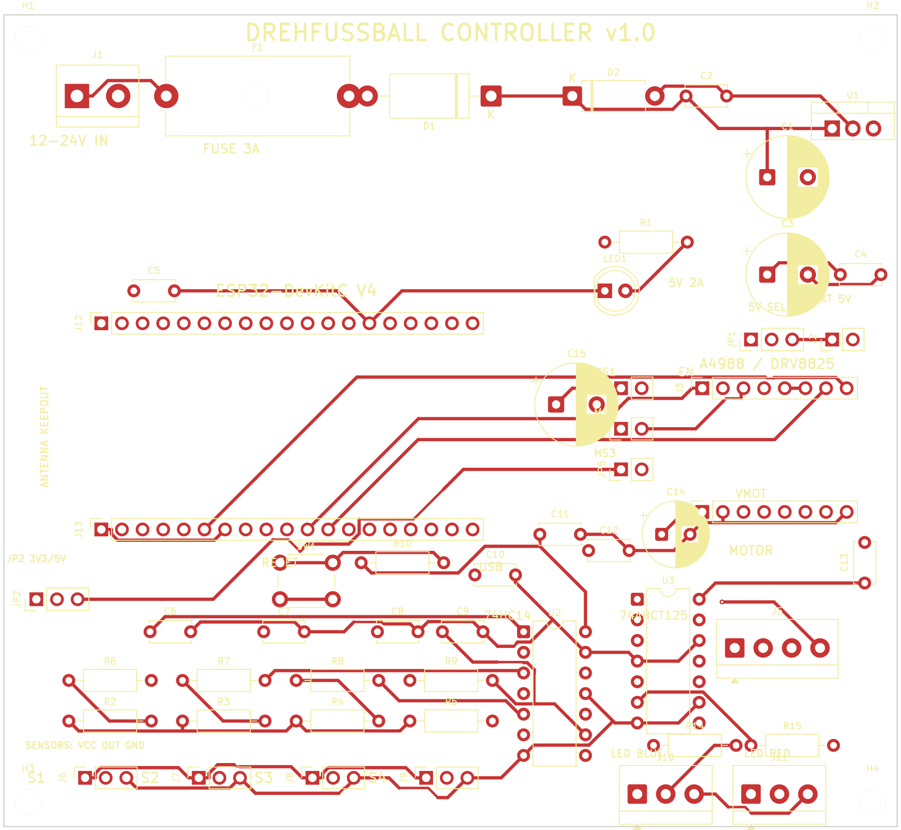

# Drehfussball Controller v1.0 — Platine

Trägerplatine für den automatischen Drehfußball-Tisch:

- ESP32-DevKitC V4 (38-Pin, **WROOM-32**, kein WROVER)
- A4988- / DRV8825-Schrittmotortreiber (2×8-Sockel)
- 2× IR-Lichtschranke (eine pro Schacht); 4 Eingänge auf der Platine (2 Reserve), 74HC14-Schmitt-Trigger
- 2× WS2812B-Streifen (5 V, 74AHCT125-Pegelwandler)
- Reset-Taster
- 12–24-V-Eingang mit 3-A-Sicherung, Verpolschutz, TVS und 5-V/2-A-Schaltregler



## Technische Daten

| Eigenschaft | Wert |
|---|---|
| Maße | 110 × 100 mm |
| Lagen | 2 (F.Cu / B.Cu) |
| Material | FR4, 1,6 mm, HASL |
| Bestückung | THT (keine SMD-Bauteile) |
| Min. Leiterbahn | 0,20 mm (geroutet: 0,20–0,40 mm, überwiegend 0,40 mm) |
| Min. Freiraum | 0,20 mm |
| Min. Bohrdurchmesser | 0,30 mm (Vias), 0,80 mm (DIP) |
| DRC (KiCad 9.0.2) | **0 Verstöße, 0 unverbundene Pads** |
| Routing | FreeRouting, überwiegend 0,40-mm-Tracks, B.Cu-GND-Fläche |
| Montage | 4× M3 (3,2 mm) |

## Stromversorgung

| Anschluss | Belegung |
|---|---|
| **J1** 12–24 V IN | 1 = +12…24 V, 2 = GND |
| **F1** | 5×20 mm, 3 A träge |
| **D1** | SR560, Verpolschutz (Kathode Richtung VIN_PROT) |
| **D2** | P6KE33A, TVS |
| **U1** | TSR2-2450, 5 V / 2 A (TO-220 SIP-3: 1 = IN, 2 = GND, 3 = OUT) |
| **JP1** | 1 = 5V_BUCK, 2 = +5 V, 3 = 5V_EXT; **1–2 = interner Regler**, 2–3 = externes 5 V |
| **J2** | 1 = 5V_EXT, 2 = GND |
| **JP2** | 1 = 3,3 V, 2 = SENSOR_VCC, 3 = 5 V; **1–2 = 3,3-V-Sensoren (Default)**, 2–3 = 5-V-Sensoren |

**Wichtig:** Niemals JP1 auf 2–3 stecken und gleichzeitig eine externe 5-V-Quelle an J2 anlegen, während der interne Regler bestückt ist. Im Zweifel JP1 abziehen.

Die 3,3 V kommen aus dem ESP32-DevKitC (AMS1117). Die Sensor-Pull-ups liegen immer an 3,3 V, auch wenn JP2 auf 5 V steht — dadurch sind 5-V-Open-Collector-Sensoren sicher.

**Stromreserve:** 5 V / 2 A. Das ESP32-Modul zieht ca. 0,5 A, die Sensorik ca. 0,1 A, der A4988-Logikteil ca. 0,05 A. Die Firmware begrenzt die LED-Streifen auf 500 mA. Für beide Streifen in voller Helligkeit (20 × 60 mA = 1,2 A) reicht der Regler gerade; besser ein separates 5-V-Netzteil für die LEDs verwenden und GND verbinden.

## Anschlüsse

### ESP32-DevKitC (J12 = J2-Header, J13 = J3-Header)

| J12 | Funktion | J13 | Funktion |
|---|---|---|---|
| 1 | 3V3 | 1 | GND |
| 2 | EN | 2 | IO23 |
| 3 | VP / IO36 | 3 | IO22 |
| 4 | VN / IO39 | 4 | TX / IO1 |
| 5 | IO34 | 5 | RX / IO3 |
| 6 | IO35 | 6 | **IO21 → DIR** |
| 7 | **IO32 → S3 (Tor 2)** | 7 | GND |
| 8 | **IO33 → BTN** | 8 | IO19 |
| 9 | **IO25 → LED_RED_DIN** | 9 | IO18 |
| 10 | **IO26 → LED_BLUE_DIN** | 10 | IO5 |
| 11 | **IO27 → S1 (Tor 1)** | 11 | **IO17 → EN** |
| 12 | IO14 → S2 (Reserve) | 12 | **IO16 → STEP** |
| 13 | IO12 (nicht verwendet!) | 13 | IO4 |
| 14 | GND | 14 | IO0 |
| 15 | IO13 → S4 (Reserve) | 15 | IO2 |
| 16 | D2 / IO9 | 16 | IO15 |
| 17 | D3 / IO10 | 17 | D1 / IO8 |
| 18 | CMD / IO11 | 18 | D0 / IO7 |
| 19 | 5V | 19 | CLK / IO6 |

**GPIO12 ist absichtlich frei.** Es ist ein Strapping-Pin (MTDI); ein Pull-up am Sensorausgang würde den ESP32 beim Booten auf 1,8 V Flash-Spannung stellen. Deshalb liegt Tor 2 auf **GPIO32**.

**Nur WROOM-32 verwenden.** Beim WROVER sind GPIO16/17 für PSRAM reserviert — STEP/EN würden nicht funktionieren.

### A4988 / DRV8825 (J3 = obere Reihe, J4 = untere Reihe)

| J3 | Funktion | J4 | Funktion |
|---|---|---|---|
| 1 | EN (GPIO17) | 1 | VMOT (12–24 V) |
| 2 | MS1 (JP3) | 2 | GND |
| 3 | MS2 (JP4) | 3 | 2B |
| 4 | MS3 (JP5) | 4 | 2A |
| 5 | RST (+5 V) | 5 | 1A |
| 6 | SLP (+5 V) | 6 | 1B |
| 7 | STEP (GPIO16) | 7 | VDD (+5 V) |
| 8 | DIR (GPIO21) | 8 | GND |

- **RST und SLP sind auf der Platine fest mit +5 V verbunden.**
- **JP3/JP4/JP5** schalten MS1/MS2/MS3 auf +5 V. Offen = Low (interne Pulldowns im A4988).
- A4988: alle drei geschlossen = 1/16. DRV8825: alle drei geschlossen = 1/32.
- **J5 MOTOR:** 1 = 1A, 2 = 1B, 3 = 2A, 4 = 2B.
- Modul mit Pin 1 (EN) an J3 Pin 1 einstecken; Trimpot nach oben. **Stromgrenze vor dem Anschließen des Motors einstellen.**

### Lichtschranken (J6 / J8)

Der Ball läuft im geschlossenen Schacht an der Lichtschranke vorbei. Eine Schranke pro Seite reicht; niemand kann in den Schacht greifen, deshalb ist keine Doppelstrahl- oder Hand-Erkennung nötig.

| Anschluss | Tor | GPIO | Status |
|---|---|---|---|
| J6 / S1 | Tor 1 (blau) | 27 | **verwendet** |
| J8 / S3 | Tor 2 (rot) | 32 | **verwendet** |
| J7 / S2 | Reserve | 14 | optional |
| J9 / S4 | Reserve | 13 | optional |

Belegung: **1 = VCC (JP2), 2 = OUT, 3 = GND**.

- Die 74HC14 **invertieren**: Strahl unterbrochen → **GPIO HIGH**.
- 10 kΩ Pull-up auf 3,3 V, 1 kΩ Serienwiderstand, 100 nF gegen GND.
- **Sender:** Der 3-polige Header versorgt den Empfänger. Der IR-Sender (2-polig) wird parallel an VCC/GND angeschlossen; Vorwiderstand passend zur LED (bei 3,3 V ca. 100 Ω, bei 5 V ca. 180 Ω für 20 mA). Bei fertigen 3-Draht-Modulen mit integriertem Sender entfällt das.
- Die Platine ist für **3,3–5-V-Open-Collector-Module** ausgelegt. Für 12–24-V-Industriesensoren wäre ein Optokoppler nötig (nicht auf dieser Version).

**Bestückung der Reserve-Kanäle:** R2–R9 und C6–C9 trotzdem vollständig bestücken, auch wenn J7/J9 leer bleiben. Sonst können die ungenutzten 74HC14-Eingänge floaten. Die Buchsen J7/J9 selbst sind optional.

### LEDs (J10/J11)

| Anschluss | Belegung |
|---|---|
| J10 LED BLUE | 1 = 5 V, 2 = DIN (GPIO26 über U3), 3 = GND |
| J11 LED RED | 1 = 5 V, 2 = DIN (GPIO25 über U3), 3 = GND |

- 74AHCT125 wandelt 3,3 V auf 5 V; 330 Ω Serienwiderstand; 1000 µF Stützkondensator.
- WS2812B, 10 LEDs pro Streifen (wie in der Firmware).

## Bestückung

### BOM (Platine)

Die vollständige, gruppierte Liste steht in [`BOM_grouped.csv`](BOM_grouped.csv); die Einzelpositionen in [`BOM.csv`](BOM.csv).

| Menge | Wert | Referenzen |
|---:|---|---|
| 11 | 100 nF | C2, C4–C13 |
| 1 | 470 µF / 50 V | C1 |
| 1 | 470 µF / 10 V | C3 |
| 1 | 100 µF / 50 V | C14 |
| 1 | 1000 µF / 10 V | C15 |
| 5 | 10 kΩ | R2–R5, R10 |
| 5 | 1 kΩ | R1, R6–R9 |
| 2 | 330 Ω | R14, R15 |
| 1 | SR560 | D1 |
| 1 | P6KE33A | D2 |
| 1 | LED grün 5 mm | LED1 |
| 1 | TSR2-2450 | U1 |
| 1 | 74HC14 (DIP-14) | U2 |
| 1 | 74AHCT125 (DIP-14) | U3 |
| 1 | Taster 6 mm | SW1 |
| 1 | 5×20-mm-Sicherungshalter | F1 |
| 2 | 1×19-Pin-Socket | J12, J13 |
| 2 | 1×8-Pin-Socket | J3, J4 |
| 4 | 1×3-Pin-Socket | J6–J9 (2 genutzt, 2 Reserve) |
| 1 | 2-Pin-Schraubklemme 5,08 mm | J1 |
| 3 | 3,5-mm-Schraubklemme, 3/3/4-polig | J10, J11, J5 |
| 4 | 1×2-Stiftleiste | J2, JP3, JP4, JP5 |
| 2 | 1×3-Stiftleiste | JP1, JP2 |
| 4 | M3-Bohrung | H1–H4 |

### Externe Teile (nicht auf der Platine)

- ESP32-DevKitC V4, 38-Pin, **ESP32-WROOM-32E**
- A4988- oder DRV8825-Modul, 2×8, 0,6″
- 2× IR-Lichtschrankenpaar (eine pro Schacht, Sender + Empfänger, 3,3–5 V, Open Collector)
- 1× Feinsicherung 5×20 mm, 3 A träge
- 2× WS2812B-Streifen, 5 V, 10 LEDs
- 12–24-V-DC-Netzteil (mind. 2 A für den Motor; 5-V-Zweig max. 2 A)
- Schrittmotor, 4-adrig
- Jumper-Kappen für JP1–JP5
- Optional: Kühlkörper für U1 bei >1 A Dauerstrom

### Bestückungsreihenfolge

1. Widerstände und Dioden (R1–R15, D1, D2)
2. Keramik- und Elko-Kondensatoren (auf Polarität achten: C1, C3, C14, C15)
3. DIP-14-Sockel für U2/U3, dann ICs einsetzen
4. Taster SW1, LED1
5. Sicherungshalter F1, Schraubklemmen J1/J5/J10/J11
6. Stiftleisten JP1–JP5, J2
7. Buchsenleisten J3/J4, J6/J8 (J7/J9 Reserve), J12/J13
8. U1 (TO-220) zuletzt, ggf. Kühlkörper

**Polarität:**
- D1: Kathodenband (K) nach rechts zu VIN_PROT.
- D2: Kathodenband (K) nach links zu VIN_PROT.
- C1/C3/C14/C15: „+“-Markierung beachten (quadratisches Pad = Plus).
- LED1: Kathode (flache Seite) an GND.

**Antennen-Keepout:** Der linke Bereich (x = 0…11 mm, y = 33…70 mm) ist auf beiden Lagen copper-free. Dort darf kein Metall und kein Kabel liegen; die ESP32-Antenne zeigt nach links.

## Firmware

`src/main.cpp` ist bereits auf die Platine umgestellt:

- **Tor 1** (blau): `J6 / S1` → **GPIO27**
- **Tor 2** (rot): `J8 / S3` → **GPIO32**
- `J7 / S2` und `J9 / S4` bleiben frei.
- **74HC14 invertiert:** Strahl blockiert = `HIGH`.
- Der Taster bleibt **active-low** auf GPIO33 (nicht über den Inverter geführt).
- `STEP`/`DIR`/`EN` bleiben auf 16/21/17; die LED-Pins bleiben 26/25.

Die alte `pulseIn`/`SensorLoop`-Logik und `RunningMedian` sind entfernt. Stattdessen:

1. `attachInterrupt(..., CHANGE)` auf GPIO27 und GPIO32.
2. Die ISR trägt nur `(Tor, Flanke, Zeitstempel)` in eine FreeRTOS-Queue ein.
3. Ein Task wertet die Queue aus:
   - Blockierdauer **2–500 ms** → Tor.
   - **< 2 ms** → Störung/Schmutz, kein Tor.
   - **> 500 ms** → klemmender Ball oder Sensorfehler, kein Tor.
   - **1,5 s Cooldown** pro Seite gegen Doppelzählung.

Damit wird nicht mehr periodisch gemessen; die CPU reagiert nur auf Flanken. Zum Debuggen `DEBUG_SENSORS` in `src/main.cpp` auf `1` setzen.

### Firmware-Build

Getestet mit PlatformIO 6.x, Arduino Core 3.x (ESP-IDF 5.5) und **FastAccelStepper 2.0.0**. Die Firmware ist inkl. Dashboard ca. 1,4 MB groß; deshalb steht in `platformio.ini`:

```ini
board_build.partitions = huge_app.csv
```

Das gibt eine 3-MB-App-Partition (statt 1,25 MB) und 1 MB SPIFFS. Ohne diese Zeile schlägt der Linker mit „program size is greater than maximum allowed“ fehl.

```bash
pio run                 # kompilieren
pio run -t upload       # flashen
```

### Dashboard lokal / TV

Das Web-Dashboard liegt unter [`../dashboard/`](../dashboard/) und ist dieselbe
Oberfläche, die der ESP32 ausliefert.

```bash
cd dashboard
python3 -m pip install -r requirements.txt
python3 server.py
```

- **Live / Operator:** <http://localhost:8000/>
- **TV:** <http://localhost:8000/tv> (oder `?tv=1`)
- **Demo:** <http://localhost:8000/?demo=1&tv=1>

Auf dem ESP32: `http://192.168.4.1/` bzw. `http://192.168.4.1/?tv=1`
(oder `/tv`). Der lokale Server simuliert den WebSocket nur; die echte
Firmware läuft auf dem ESP32.

Nach Dashboard-Änderungen `python3 dashboard/build_site.py` ausführen (macht
`server.py` beim Start automatisch) und anschließend `pio run -t upload`.

Details: [`../dashboard/README.md`](../dashboard/README.md)

## Build (optional)

Die Platine lässt sich mit den Skripten in diesem Ordner reproduzieren. Benötigt werden KiCad 9 (`kicad-cli`, `pcbnew`), Java 25 und FreeRouting 2.5. Für den Schaltplan zusätzlich `kicad-sch-api` (pip) und `KICAD_SYMBOL_DIR`. Die Pfade lassen sich über die Umgebungsvariablen `JAVA`, `FREEROUTING` und `KICAD_CLI` überschreiben.

```bash
export LD_LIBRARY_PATH=/pfad/zu/kicad/usr/lib/x86_64-linux-gnu
export PYTHONPATH=/pfad/zu/kicad/usr/lib/python3/dist-packages
python3 build.py            # Platzierung, Routing, DRC, Gerber
python3 generate_schematic.py
python3 generate_docs.py
```

## Fertigung

- Gerber + Bohrdaten: [`Drehfussball_Controller_Gerber.zip`](Drehfussball_Controller_Gerber.zip)
- Enthalten: F.Cu, B.Cu, F/B-Maske, F/B-Silkscreen, Edge.Cuts, PTH/NPTH-Drill, `.gbrjob`
- 2 Lagen, 1,6 mm, HASL, min. Track 0,2 mm, min. Drill 0,3 mm
- Bei JLCPCB/PCBWay/Aisler direkt als ZIP hochladen; 5 Stück sind ausreichend.

## Dateien

| Datei | Inhalt |
|---|---|
| `Drehfussball_Controller.kicad_pcb` | KiCad-9-PCB, geroutet |
| `Drehfussball_Controller.kicad_pro` | Projektdatei (DRC-Regeln) |
| `Drehfussball_Controller.kicad_sch` | KiCad-9-Schaltplan (Netzlabels) |
| `Drehfussball_Controller_Schematic.pdf` | Schaltplan als PDF |
| `BOM.csv` / `BOM_grouped.csv` | Stücklisten |
| `connections.csv` | Netz → Bauteil/Pad |
| `gerber/` | Einzelne Gerber- und Bohrdaten |
| `Drehfussball_Controller_Gerber.zip` | Fertigungspaket |
| `final_top.png` / `final_all.png` | Vorschau Top / beide Lagen |
| `schematic.png` | Vorschau Schaltplan |
| `generate_board.py` | Erzeugt Platzierung + Netze |
| `build.py` | Kompletter Build: Route, DRC, Gerber |
| `generate_schematic.py` | Erzeugt den KiCad-Schaltplan |
| `generate_docs.py` | Erzeugt BOM- und Verbindungstabellen |
| `../src/main.cpp` | Firmware: IR-Auswertung, LEDs, Stepper, WebSocket |
| `../platformio.ini` | PlatformIO: FastAccelStepper 2.0.0, huge_app-Partition |
| `../dashboard/` | Dashboard-Quelle, lokaler Mock-Server, TV-Ansicht |

## Bekannte Einschränkungen

- Der Schaltplan ist **automatisch** aus denselben Netzen erzeugt und nutzt Netzlabels an jedem Pin. Er ist elektrisch konsistent, aber optisch dicht; für eine „schöne“ Zeichnung in KiCad öffnen und aufräumen.
- Der Schaltplan zeigt alle vier Sensor-Kanäle. Genutzt werden **S1 (J6)** und **S3 (J8)**; S2/S4 sind Reserve.
- Die 5-V-Leiterbahnen sind 0,3–0,4 mm. Für >1,5 A Dauerstrom besser ein separates 5-V-Kabel an J10/J11 führen oder die Bahnen verbreitern.
- Die IR-Sensoren sind extern; die Platine erwartet 3,3–5-V-Open-Collector-Module. 12–24-V-Industriesensoren brauchen einen Optokoppler.
- Das A4988-Modul, der ESP32, die LED-Streifen, der Motor und das Netzteil sind **nicht** Teil der Platine.
- Die DRC-Prüfung ignoriert reine Silk-/Courtyard-Überlappungen (kosmetisch). Elektrische Prüfungen (Kurzschluss, Freiraum, unverbundene Pads) sind aktiv und sauber.

## Lizenz / Haftung

Prototypen-Design. Vor der Fertigung die Gerber im Viewer prüfen und die Bestückung gegen die eigene Mechanik kontrollieren. Keine Gewähr für Richtigkeit der Pinbelegung oder für Schäden an ESP32, Treiber, Motor oder Netzteil.
